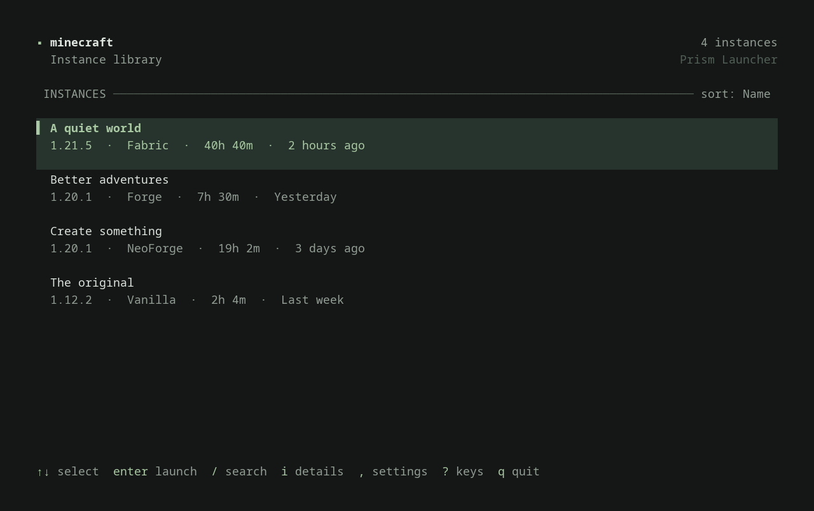
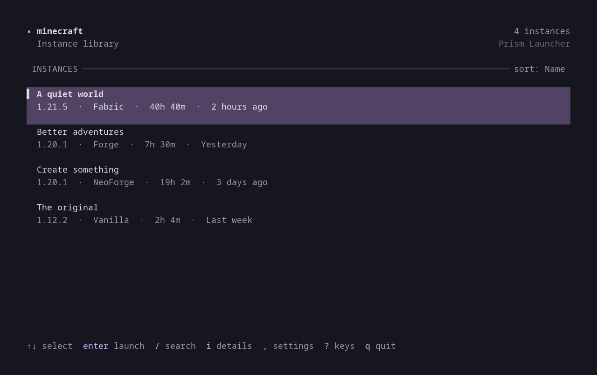
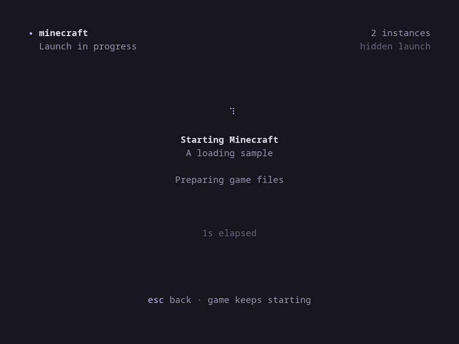

# Minecraft TUI



*Preview: Sage theme.*

A quiet, keyboard-driven library for your [Prism Launcher](https://prismlauncher.org/) instances. Built with Rust and Ratatui, with restrained styling, a choice of themes, and room for the things that matter.

- Search and sort instances by name, last played, or playtime.
- See Minecraft versions, mod loaders, installed mods, and running instances.
- Open instance folders or launch a game directly from the terminal.
- Match your terminal colors or choose a built-in theme.
- Follow hidden launches in the terminal with a spinner and elapsed time.
- Keep your preferences, including an optional hidden Prism window.
- Use native Prism Launcher or its Flatpak package on Linux.

## Build and run

You need Linux, a current stable Rust toolchain, and Prism Launcher with an account and at least one configured instance. `xdg-open` is needed only to open instance folders.

From this checkout:

```bash
cargo build --release
./target/release/minecraft-tui
```

To install the binary in `~/.local/bin`:

```bash
./install.sh
```

Ensure `~/.local/bin` is in your `PATH`. Launching is handled by the binary; copying a helper script to `~/scripts` is no longer required.

Try the interface with sample instances:

```bash
cargo run -- --demo
```

Demo mode does not launch games or save preferences.

## Keys

| Key | Action |
| --- | --- |
| `↑` / `↓`, `k` / `j` | Select an instance |
| `Enter` | Launch the selected instance |
| `/` | Search by name; type to filter |
| `Esc` in search | Clear the search and return to the library |
| `s` | Cycle sort: name → last played → playtime |
| `i` | Toggle instance details |
| `o` | Open the selected instance folder |
| `r` | Refresh instances |
| `,` | Open settings |
| `?` | Show keyboard help |
| `q` / `Esc` | Quit or close the current overlay |
| `Ctrl-C` | Quit |

In settings, use `↑` / `↓` to select a preference and `Enter` or `Space` to change it. On the **Theme** row, `←` / `→` cycle backward or forward; `Enter` or `Space` selects the next theme. Changes apply immediately and are saved. On narrow terminals, details replace the library; press `i` to return.

## Themes

Open settings with `,` and select the third row, **Theme**:

| Theme | Appearance |
| --- | --- |
| **Terminal** (default) | Uses your terminal's background and ANSI palette, preserving terminal-managed transparency. |
| **Sage** | The original graphite background with a soft green accent. |
| **Violet** | A dark purple background with a lilac accent. |
| **Paper** | A light background with muted accents. |

The Terminal theme follows the terminal's configured colors; the other themes use fixed palettes. Existing settings files without a `theme` field use Terminal automatically.



*Violet theme.*

## Hide the Prism window

Open settings with `,` and enable **Hide launcher window**. This is off by default.

Prism has no dedicated command-line switch for hiding its launch progress dialog. This option starts it with Qt's `-platform offscreen`, hiding the launcher's windows while Minecraft opens normally. It does not change Prism's own settings or the game's environment.

Complete account sign-in, Java setup, and any interactive prompts in visible Prism first. Offscreen mode also hides sign-in and error dialogs; turn the option off if a launch needs attention. Close any existing Prism process before using it: an already running launcher handles launch requests with its existing window settings.

When hidden launch is enabled, pressing `Enter` keeps the terminal open with a loading screen: a spinner, elapsed time, and the current preparation stage. It follows the selected theme and shows no estimated percentage. The TUI closes when it detects the instance's Minecraft Java process; this means the process has started, not that its game window is ready.



- `Esc` returns to the library while Prism continues preparing the game. Press `Enter` on the same instance to reopen its loading screen. Another launch is blocked while preparation is being monitored.
- `q` or `Ctrl-C` closes the TUI while the launch continues.
- A detected failure returns to the library with a brief error and a launch log hint.
- After two minutes without detecting the game process, the TUI returns to the library with an attention message. This ends monitoring without stopping Prism or Minecraft; check the log or try a visible launch if interaction is needed.

If the game process is detected after you have returned with `Esc`, the library stays open and shows a status message instead of closing.

Minecraft continues running after the TUI closes. Launch output is saved to `$XDG_STATE_HOME/minecraft-tui/launcher.log`, or `~/.local/state/minecraft-tui/launcher.log` when unset. Each new launch moves the previous log to a `launcher-*.log` archive in the same directory. If your Qt installation lacks the offscreen platform plugin, disable this option and check the current log.

## Data and preferences

Instances are discovered in the standard locations:

- Native: `$XDG_DATA_HOME/PrismLauncher/instances`, or `~/.local/share/PrismLauncher/instances` when unset.
- Flatpak: `~/.var/app/org.prismlauncher.PrismLauncher/data/PrismLauncher/instances`.

Preferences live at `$XDG_CONFIG_HOME/minecraft-tui/config.json`, or `~/.config/minecraft-tui/config.json` when unset:

```json
{
  "hide_launcher": false,
  "details": false,
  "theme": "terminal"
}
```

Theme values are `terminal`, `sage`, `violet`, and `paper`.

Instances and accounts remain managed by Prism Launcher. Create, import, update, and authenticate them there, then press `r` in the TUI to refresh the library.

## Development

```bash
cargo fmt -- --check
cargo clippy -- -D warnings
cargo test
```

## License

[MIT](LICENSE). Based on [KamiSenpai64/minecraft-tui](https://github.com/KamiSenpai64/minecraft-tui); original copyright and license are preserved.
